# Sultan Restaurant Enterprise Suite (SRE-Suite)
## Complete Functional Feature Specification & Operational Workflow Document

---

### Executive Summary & Value Proposition

The **Sultan Restaurant Enterprise Suite** is an all-in-one, multi-device restaurant management, kitchen operations, inventory ERP, and amusement park billing system. Built specifically for high-volume dining establishments, multi-floor luxury restaurants, traditional tandoor/handi kitchens, beverage bars, and integrated family playlands, this software eliminates operational theft, reduces food wastage, enforces strict recipe portioning, streamlines front-of-house hospitality, and guarantees complete financial visibility across every shift.

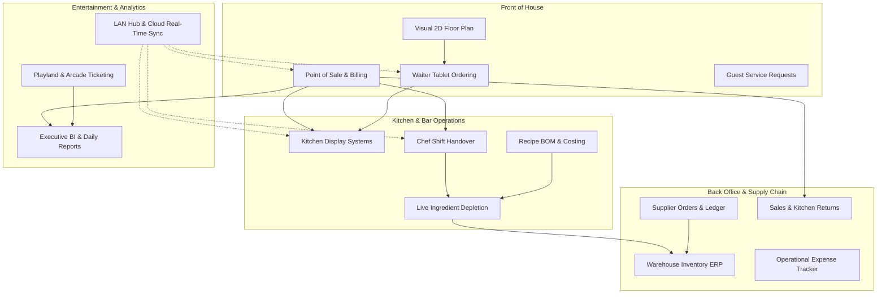

---

## Module 1: Point of Sale (POS) & Billing Engine

The core revenue engine handles high-volume order entry, split billing, customer profiles, table assignments, and instant kitchen communication with zero latency.

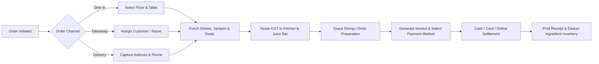

### 1.1 Multi-Channel Order Dispatching
* **Dine-In Management**: Direct binding to interactive floor plans and table numbers. Tracks running duration, server allocation, and add-on rounds.
* **Express Takeaway**: Quick-punch counter mode designed for rapid customer turnaround without requiring table assignment.
* **Home Delivery Integration**: Captures customer telephone, delivery address, dispatch time, and delivery charges.

### 1.2 Menu Catalog, Deals & Customizations
* **Category Filtering & Instant Search**: Dynamic filtering across BBQ, Karahi & Handi, Rice, Fast Food, Beverages, Desserts, and Tandoor.
* **Portion & Size Variants**: Single dishes support multi-tier sizing (e.g., *Half vs. Full*, *Small vs. Medium vs. Large*) with independent pricing.
* **Combo Deals & Family Packages**: Bundles multiple distinct dishes into promotional sets with automated pricing calculations and individual recipe stock depletions.
* **Special Kitchen Instructions**: Free-form and pre-selected chef notes per dish (e.g., *"Less Spicy"*, *"Extra Raita"*, *"No Onions"*, *"Serve Without Ice"*).
* **Automated Kitchen Routing**: The system automatically splits an order into separate tickets: savory dishes route directly to the **Main Kitchen KDS**, while shakes, juices, and cold drinks route to the **Juice Bar KDS**.

### 1.3 Flexible Settlement & Checkout
* **Multi-Tender Split Payments**: Bills can be paid simultaneously across multiple payment methods (e.g., 50% Cash + 50% Debit Card or Mobile Wallet).
* **Discount Engine**: Apply flat or percentage discounts with mandatory authorization to prevent cashier leakages.
* **Tax Calculation**: Automated sales tax calculation compliant with local hospitality regulatory frameworks.
* **Thermal Printing & Digital Slips**: Generates thermal receipts (58mm/80mm format) featuring Arabic/Urdu calligraphy, breakdown of items, order taker name, table number, and tax breakdown.
* **Audit-Controlled Bill Voiding**: Settled or active bills cannot be deleted without entering an authorized reason and logging the manager's ID.

---

## Module 2: Visual Floor Plan & Table Management

An interactive 2D layout builder and live occupancy monitor that replicates the restaurant's physical architecture.

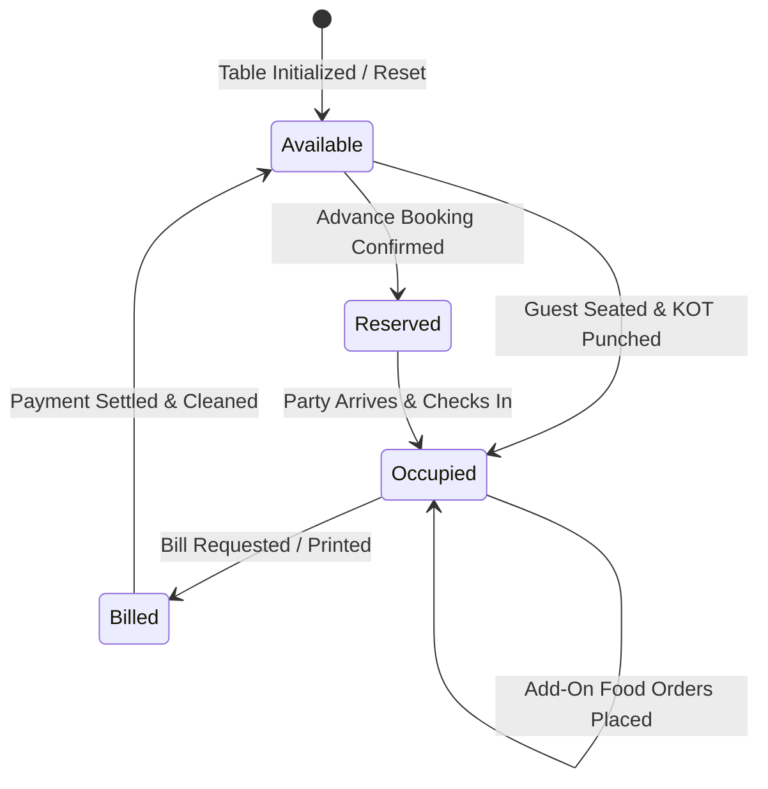

### 2.1 Multi-Floor & Multi-Zone Architecture
* **Floor Separation**: Supports multi-level premises, including **Ground Floor Dining**, **Family Hall**, **Rooftop Garden**, **VIP Executive Lounge**, and **Outdoor Patio**.
* **Specialized Seating Categories**: Distinguishes between standard dining tables, luxury couches, private dining cabins, and traditional carpeted *Majlis* seating.
* **Interactive 2D Drag-and-Drop Designer**: Management can arrange tables with custom coordinates ($X, Y$), table shapes (*Square*, *Round*, *Rectangle*), and seat capacities.

### 2.2 Live Dining State & Occupancy Monitoring
* **Color-Coded Statuses**:
  * **Green (Available)**: Free for immediate seating.
  * **Amber/Orange (Occupied)**: Seated with active dining and kitchen orders in progress.
  * **Blue (Billed)**: Bill presented to guest; awaiting payment completion.
  * **Purple (Reserved)**: Blocked for scheduled reservations.
* **Dining Duration Stopwatch**: Tracks elapsed dining time since seating to detect table hogging and improve turnover velocity.
* **Table Merging for Banquets**: Two or more adjacent tables can be merged into a single parent table to host large family feasts and corporate events under a single unified ticket.

### 2.3 Guest Service Requests (Waiter Call)
* **Real-Time Staff Paging**: Waiter terminals and manager dashboards receive audible and visual alerts for guest service requests:
  * *Call Waiter*
  * *Request Bill*
  * *Water / Refill*
  * *Clean Table*
  * *Complaint / Escalation*
* **Resolution Timestamps**: Tracks response latency from request generation to waiter acknowledgment and resolution.

---

## Module 3: Kitchen Display System (KDS) & Station Routing

Replaces paper tickets with interactive digital displays stationed directly at cooking lines and beverage counters.

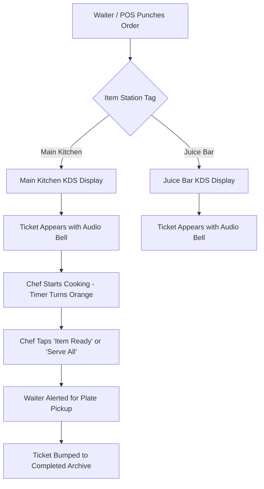

### 3.1 Station Separation & Display Terminals
* **Main Kitchen Screen**: Dedicated to hot food, Karahi, Biryani, BBQ, and Tandoor items.
* **Juice Bar Screen**: Dedicated to mocktails, fresh seasonal juices, milkshakes, ice creams, and cold desserts.
* **Ticket Elapsed Time Clocks**: Real-time timers display preparation duration; tickets transition from neutral to warning colors if orders exceed the target prep time.
* **One-Tap Bump Bar**: Chefs can mark individual dishes or entire tickets as *Cooking*, *Ready*, or *Served*.
* **Add-On Round Indicators**: Clearly highlights subsequent orders placed by the same table (Round 2, Round 3) to prevent confusion with existing dishes.

### 3.2 Real-Time "86" (Sold-Out) Manager
* **Instant Out-of-Stock Toggle**: Kitchen supervisors can mark any dish as sold out with one click.
* **Instant Waiter & POS Lockout**: The sold-out status propagates across all waiter tablets and cashier stations immediately, preventing staff from taking orders for unavailable items.

---

## Module 4: Chef Shift Handover & Real-Time Kitchen Reconciliation

The signature kitchen control engine that prevents ingredient leakages by calculating exactly how much raw material should be remaining based on live POS sales.

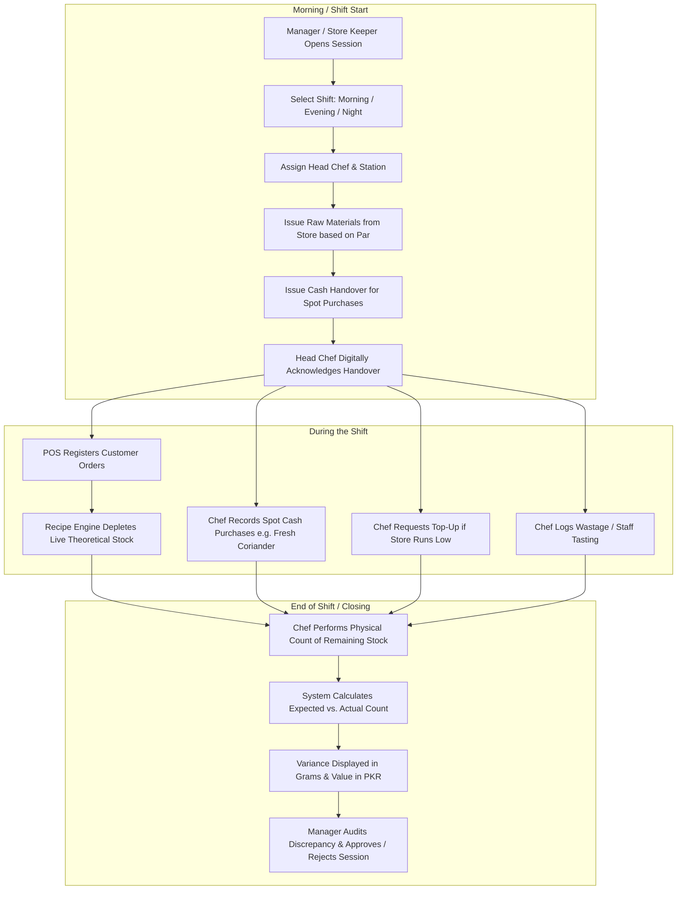

### 4.1 Shift-Based Issuance & Par Levels
* **Shift Segmentation**: Supports independent sessions for **Morning**, **Afternoon**, **Evening**, **Night**, and **Full Day** shifts.
* **Head Chef Accountability**: Every handover is assigned to a specific chef who must digitally acknowledge receipt of the ingredients.
* **Par-Level Suggestions**: System suggests ingredient quantities based on historical sales velocity and par levels, preventing over-requisitioning.
* **Starting Inventory Snapshot**: Freezes a snapshot of warehouse stock at the time of issuance to maintain audit integrity.

### 4.2 Petty Cash Handover & Emergency Sourcing
* **Kitchen Cash Float**: Record cash issued to the head chef for emergency local market purchases (e.g., fresh lemon, green chilies, emergency yogurt).
* **Expense & Invoice Logging**: Chefs log cash disbursements, item receipts, quantities, and cash balance in real time.
* **Cash Variance Calculation**: Compares original cash float against verified purchases and physical returned cash.

### 4.3 In-Shift Modifications & Kitchen Operations
* **Authorized Top-Ups**: When an unexpectedly busy evening causes an ingredient shortage, supervisors can issue formal Top-Ups rather than unauthorized stock grabs.
* **Culinary Adjustment Logging**: Chefs log ingredient usage not tied to customer sales:
  * *Quality Tasting / Recipe Tuning*
  * *Accidental Kitchen Spoilage / Overcooking*
  * *Authorized Staff Meals*

### 4.4 Automated Closing Reconciliation & Variance Audit
* **Physical Count Submission**: At shift end, the chef inputs the exact remaining balance of each issued raw material (in kg, grams, liters, or pieces).
* **Live Mathematical Reconciliation**:
  $$\text{Expected Closing Stock} = \text{Issued} + \text{Top-Ups} + \text{Local Purchases} - \text{Recipe Consumption} - \text{Logged Spoilage}$$
* **Variance Highlighting**: Discrepancies between physical count and expected count are highlighted in red (shortage) or blue (surplus), along with the monetary cost of the variance.
* **Manager Sign-Off**: The shift cannot close without formal manager sign-off, notes, and approval/rejection logging.

---

## Module 5: Dynamic Recipe Management (BOM) & Food Costing Engine

Transforms the restaurant menu from static prices into an engineering Bill of Materials (BOM) with automated cost calculations.

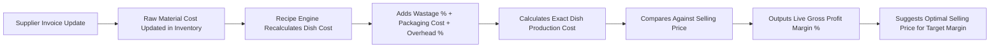

### 5.1 Granular Bill of Materials (BOM)
* **Fractional Precision**: Supports ingredients measured down to the gram ($g$), milligram ($mg$), milliliter ($ml$), liter ($L$), and individual piece ($pcs$).
* **Variant-Specific Formulations**: Define distinct ingredient quantities for portion variants (e.g., *Half Chicken Handi* uses 500g chicken, while *Full Handi* uses 1000g chicken).
* **Shrinkage & Trimming Loss (%)**: Accounts for prep shrinkage and fat trim (e.g., 1000g raw mutton yields 820g usable meat after bone/fat trimming, reflecting a 18% wastage factor).
* **Category Recipe Templates**: Rapidly initialize new recipes by applying pre-configured base ingredient templates (e.g., applying standard Karahi spices to new meat variants).

### 5.2 Dynamic Cost & Margin Engineering
* **Live Ingredient Cost Sync**: Whenever a supplier purchase invoice is approved with a higher or lower ingredient price, all dish costs recalculate automatically.
* **Fixed Overhead & Packaging Integration**: Adds fixed takeaway packaging costs (boxes, foil, sauce cups) and operational overhead percentage into the dish base cost.
* **Target Margin & Pricing Recommender**: Users specify their desired target gross margin (e.g., 65%); the engine automatically outputs the recommended menu price rounded to the nearest tens or hundreds.

---

## Module 6: Advanced Inventory & Warehouse Stock Control

An enterprise-grade stock keeping and warehouse management module with automated alerts and batch tracking.

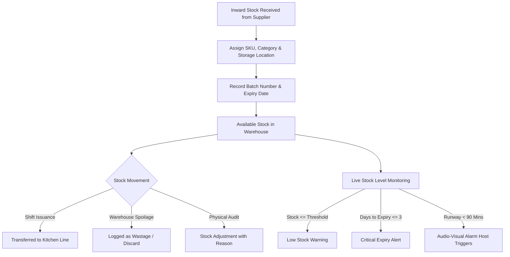

### 6.1 Multi-Category Catalog & Dual-Language Identification
* **Dual-Language Item Master**: Features both English and Urdu product titles (e.g., *Chicken Boneless / چکن بون لیس*, *Wheat Flour / فائن آٹا*) ensuring operational clarity for warehouse staff and kitchen helpers.
* **Hierarchical Categorization**: Dedicated tracking across **Meat & Poultry**, **Produce**, **Grains**, **Dairy**, **Pantry & Spices**, **Beverages**, **Commercial Fuel (LPG & Charcoal)**, and **Packaging Materials**.

### 6.2 Storage Locations & Expiry Safeguards
* **Storage Zone Assignment**: Track exact storage locations: *Walk-in Chiller*, *Deep Freezer #1 (Meat)*, *Deep Freezer #2 (Poultry)*, *Dry Ration Shelf A/B*, *Spice Rack*, and *Packaging Depot*.
* **Batch Numbering & Inward Delivery Tracing**: Links every stored item to its inward supplier invoice and supplier delivery batch.
* **Multi-Tier Expiry Warning System**:
  * **Fresh (Green)**: Ample shelf life remaining.
  * **Warning (Amber)**: 7 days or fewer until expiration.
  * **Critical (Orange)**: 3 days or fewer; demands immediate prep utilization.
  * **Expired (Red)**: Prohibits issuance to prevent food safety violations.

### 6.3 Real-Time Stock Movement Ledger & Audio Alarms
* **Complete Stock Movement Audit**: Every movement is classified as *Receive*, *Usage*, *Wastage*, or *Adjustment*, logging the delta quantity, timestamp, authorized staff member, and explanatory notes.
* **Audio-Visual Stock Alarm Host**: Monitors depletion speed during peak dining rushes; sounds audio alarms if high-velocity ingredients fall below safety runway thresholds.

---

## Module 7: Supplier Procurement & Vendor Accounts Ledger

A supplier relationship and accounts payable system that eliminates ghost deliveries and overbilling.

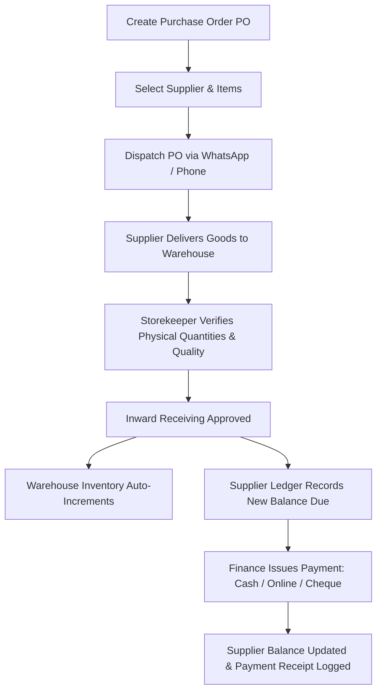

### 7.1 Vendor Master Directory
* **Supplier Profiles**: Maintains company name, primary contact person, phone numbers, email, physical warehouse address, and bank account information (Account Title, Account Number, IBAN).
* **Direct Communication**: One-touch phone dialing and instant WhatsApp order dispatch from within the application.
* **Credit Terms Configuration**: Configurable credit arrangements per supplier: *Cash on Delivery (COD)*, *Credit 7 Days*, *Credit 15 Days*, *Credit 30 Days*, or *Advance Deposit*.

### 7.2 Purchase Order (PO) Management
* **PO Creation & Tracking**: Draft, approve, and track purchase orders from creation to partial or full fulfillment.
* **Inward Goods Verification**: Verifies ordered quantities against physically delivered stock; supports partial receiving with line-item discrepancy notes.
* **Automatic Stock Sync**: Approving an inward delivery automatically updates stock levels and updates cost-per-unit values across the recipe engine.

### 7.3 Accounts Payable (A/P) Ledger & Payment Processing
* **Running Balance Ledger**: Real-time tracking of total purchases, cumulative payments made, and current outstanding liabilities for every vendor.
* **Multi-Method Payment Settlement**: Record payments via *Cash*, *Bank Wire Transfer*, or *Bank Cheque* (including cheque number, issue date, and bank branch).

---

## Module 8: Sales & Order Returns Management (Refund Engine)

A structured return and refund workflow that handles customer complaints, spilled orders, and billing errors with complete accounting transparency.

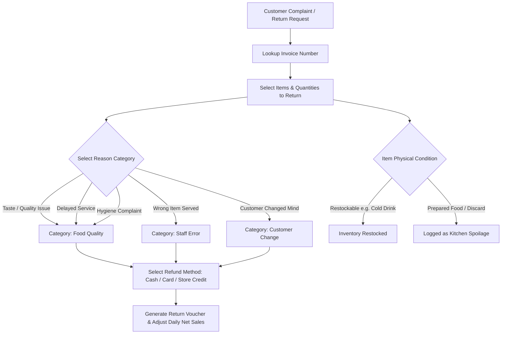

### 8.1 Transparent Return Reason Categorization
Every return requires mandatory classification into standardized operational categories:
1. **Taste / Quality Issue**: Food too cold, unpalatable, or spice level incorrect.
2. **Wrong Item Served**: Server or cashier punched the wrong dish or variant.
3. **Delayed Service**: Preparation exceeded acceptable dining thresholds.
4. **Customer Changed Mind**: Customer cancelled prior to food service or ordered excess portions.
5. **Burnt / Undercooked**: Tandoor or kitchen cooking defect; meat raw inside or bread charred.
6. **Hygiene Complaint**: Cleanliness violation or foreign particle reported.
7. **Accidental Spill / Damage**: Food dropped in dining hall or damaged in transit.
8. **Billing / Punch Error**: Cashier accidentally rung up an extra quantity.

### 8.2 Inventory Disposition & Refund Processing
* **Item Disposition Control**:
  * **Waste (Culinary Discard)**: The item cannot be re-served; logged as kitchen wastage to protect inventory accuracy.
  * **Restock (Warehouse Return)**: Unopened beverages, pre-packaged goods, or untouched items are returned directly to stock.
* **Refund Channels**: Issues refunds via Cash Drawer, Card Reversal, Customer Store Credit, or original payment method.
* **Financial Ledger Sync**: Automatically deducts refund amounts from the cashier's daily cash drawer and net sales reports.

---

## Module 9: Playland & Amusement Park Ticketing System

A specialized family entertainment module that operates alongside restaurant billing, perfect for venues featuring integrated children's play areas, rides, and arcade games.

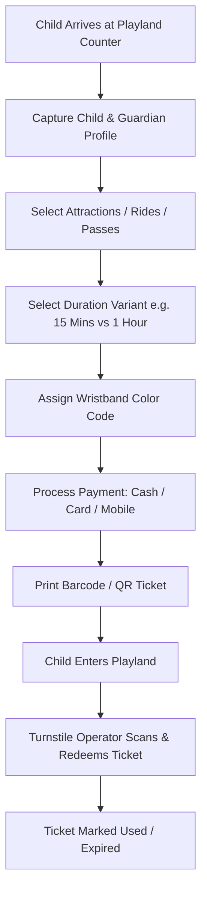

### 9.1 Multi-Attraction Catalog
* **Ride Categories**:
  * **Jhoola & Mechanical Rides**: Carousel, Mini Train, Flying Chairs.
  * **Arcade Games**: Basketball shooters, racing simulators, air hockey.
  * **Virtual Reality (VR)**: Immersive VR pods and interactive motion games.
  * **Softplay Arena**: Ball pits, obstacle courses, multi-level slides.
  * **Unlimited Passes & Bundles**: Full-day passes and multi-ride privilege wristbands.
* **Duration-Based Tiering**: Rides support flexible durations (e.g., *5 Mins*, *10 Mins*, *15 Mins*, *1 Hour*) with automated price scaling.

### 9.2 Wristband Color-Coding & Safety Profile
* **Wristband Color Association**: Assigns wristband colors to visual age groups or session time slots for quick floor monitoring.
* **Child & Guardian Records**: Logs child's name, age, guardian's phone number, and visit counts for loyalty tracking and security checkouts.

### 9.3 Ticket Redemption & Financial Auditing
* **Barcode & Ticket Code Issuance**: Prints thermal tickets with unique scannable alphanumeric codes.
* **Ride Operator Redemption**: Turnstile operators scan tickets to redeem entries and prevent duplicate admissions.
* **Independent Playland Financials**: Generates separate revenue reports for amusement rides, preventing F&B sales from mixing with entertainment income.

---

## Module 10: Waiter Mobility & Guest Table Experience

A lightweight, high-performance tablet portal designed for floor captains and servers to take orders tableside without pen and paper.

### 10.1 Mobile Floor Navigation
* **Zone-Based Filtering**: Waiters can filter tables by their assigned station (e.g., *Family Section*, *Rooftop Terrace*, *Executive Cabins*).
* **Live Occupancy Colors**: Instant visual feedback of free, occupied, and billed tables.
* **Table Locking**: Prevents two servers from taking conflicting orders on the same table simultaneously.

### 10.2 Tableside Order Entry
* **Rapid Dish Selection**: Big-button visual layout designed for fast order entry during loud, busy dining shifts.
* **Add-On Round Sequencing**: Intelligently tags subsequent orders with sequential round numbers (Round 1, Round 2) so the kitchen prepares food in courses.
* **Live Guest Service Requests**: Waiters receive real-time notifications when a guest taps "Call Waiter" or "Water Refill" from their table.

---

## Module 11: Expense & Petty Cash Management

Captures daily out-of-pocket operational costs directly from the cash drawer to prevent end-of-shift cash shortages.

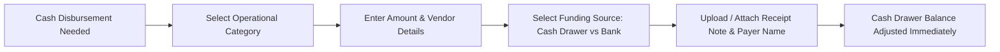

### 11.1 Standardized Expense Categories
* **Utility & Fuel**: LPG commercial gas cylinders, BBQ charcoal bags, generator diesel, electricity bills.
* **Daily Groceries**: Local emergency vegetable and dairy purchases.
* **Staff Advances & Daily Wages**: Formal recording of wage advances and kitchen helper stipends.
* **Premise Maintenance**: Electrical repairs, plumbing, sanitization supplies, AC servicing.
* **Marketing & Packaging**: Takeaway box deliveries, social media promotions, print collateral.

### 11.2 Cash Float Balancing
* **Drawer Variance Prevention**: Every rupee taken from the register is tracked against an expense category, ensuring the closing cash count matches register sales minus authorized disbursements.

---

## Module 12: Executive Analytics, Reporting & Business Intelligence

Real-time executive summaries that convert operational data into actionable business intelligence for restaurant owners and directors.

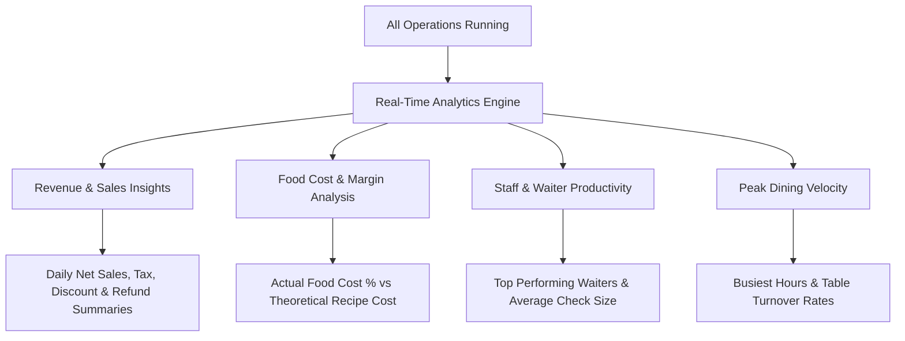

### 12.1 Revenue & Financial Reports
* **Daily Closing Report (Z-Report)**: Gross sales, net sales, taxes collected, discounts granted, return deductions, cash on hand, and card settlements.
* **Product Mix (P-Mix) Analysis**: Highlights top revenue-generating dishes, bestsellers, and lagging menu items.
* **Meal Period Breakdown**: Sales segmentation across Lunch, High Tea, Dinner, and Late-Night services.

### 12.2 Kitchen Efficiency & Food Cost Metrics
* **Food Cost Percentage Tracker**: Tracks theoretical food cost against actual inventory usage to identify unexplained stock shrinkages.
* **Shift Handover Variance Auditing**: Historical log of chef discrepancies, pinpointing which shifts or stations consistently lose raw material.

---

## Module 13: Enterprise Multi-Device Sync & Resilient Architecture

Designed specifically for real-world restaurant environments where internet connections can fluctuate.

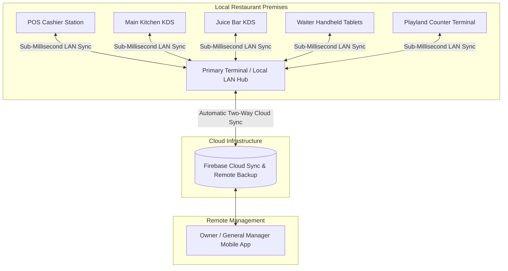

### 13.1 Local Area Network (LAN) Peer-to-Peer Hub Sync
* **Zero Downtime Guarantee**: The entire restaurant runs seamlessly over the local Wi-Fi router without requiring an active internet connection.
* **Sub-Millisecond Latency**: KDS orders, table state updates, and waiter punches sync locally between terminals instantly.

### 13.2 Automated Cloud Sync
* **Real-Time Cloud Backup**: Backs up sales records, shift closures, and inventory balances to the cloud in real time.
* **Remote Owner Dashboard**: Owners and directors can monitor live sales, active tables, and kitchen operations from anywhere in the world.

### 13.3 Role-Based Access Control (RBAC)
* **Dedicated Role Profiles**: **Admin**, **Manager**, **Cashier**, **Waiter**, **Head Chef**, **Juice Bar Barista**, and **Playland Operator**.
* **Quick PIN Authentication**: Fast staff switching using 4-digit PINs, maintaining an audit trail for every action.

---

## Comprehensive Feature Matrix & Functional Directory

| Module | Sub-Category | Feature / Capability | User Role | Business Impact |
| :--- | :--- | :--- | :--- | :--- |
| **POS** | Order Modes | Dine-In, Express Takeaway, Home Delivery | Cashier, Waiter | Rapid ordering across all customer channels |
| **POS** | Customization | Sizing Variants, Deals/Combos, Special Chef Notes | Cashier, Waiter | Accurate order prep & pricing |
| **POS** | Settlement | Multi-Tender Split (Cash, Card, Online), Tax & Discounts | Cashier | Faster checkout; stops manual math mistakes |
| **POS** | Auditing | Audit-Trail Bill Voiding with Mandatory Reason Log | Manager, Admin | Prevents cashier theft & unauthorized discounts |
| **Floor Plan** | 2D Layout | Visual Table Designer (Draggable, X/Y, Shapes) | Manager, Admin | Adapts to any restaurant floor layout |
| **Floor Plan** | Operations | Table Merging for Large Parties & Banquets | Cashier, Waiter | Seamless group dining & combined billing |
| **Floor Plan** | Guest Care | Real-Time Waiter Paging (Water, Bill, Clean, Complaint) | Waiter, Manager | Reduces guest wait times & elevates service |
| **KDS** | Routing | Automatic Split Routing: Hot Kitchen vs. Juice Bar | Kitchen, Barista | Eliminates misplaced order tickets |
| **KDS** | Execution | Elapsed Prep Clocks, Color Coded Warnings, Bump Bar | Chef, Barista | Faster meal prep & consistent ticket pacing |
| **KDS** | Inventory | 1-Tap Out-of-Stock ("86") Lockout across Tablets | Chef, Manager | Prevents taking orders for unavailable items |
| **Handover** | Shifts | Morning, Afternoon, Evening, Night & Full Shifts | Chef, Manager | Clear shift-by-shift accountability |
| **Handover** | Requisitions | Par-Level Issuance & Store Stock Snapshots | Manager, Store | Prevents over-issuing ingredients |
| **Handover** | Petty Cash | Kitchen Cash Float with Spot Purchase Receipt Log | Chef, Manager | Eliminates unaccounted kitchen cash spending |
| **Handover** | Top-Ups | In-Shift Top-Up Requests & Supervisor Approvals | Chef, Manager | Keeps kitchen stocked during busy rushes |
| **Handover** | Reconciliation | Expected vs. Actual Count with Variance in PKR | Manager, Admin | Identifies kitchen theft & recipe non-compliance |
| **Recipes** | BOM | Fractional Units (g, mg, ml, L, pcs) with Wastage % | Admin, Chef | Pinpoint accuracy in ingredient usage |
| **Recipes** | Costing | Live Recipe Cost Sync with Supplier Purchase Prices | Admin, Manager | Accurate food cost tracking despite inflation |
| **Recipes** | Engineering | Target Margin Calculator with Recommended Menu Price | Admin | Maximizes menu profitability |
| **Inventory** | Catalog | Dual Language (English + Urdu) with Item Codes | Store, Chef | Flawless stock picking for all staff |
| **Inventory** | Expiry | Color-Coded Expiry Tracking (Fresh, Warning, Critical) | Storekeeper | Prevents serving expired food |
| **Inventory** | Storage | Multi-Zone Locations (Chillers, Freezers, Dry Store) | Storekeeper | Organized stock tracking |
| **Inventory** | Alarms | Audio-Visual Safety Runway Alarms | Chef, Store | Prevents running out of key ingredients mid-rush |
| **Suppliers** | Profiles | Vendor Directory, Direct WhatsApp & Phone Links | Manager, Store | Fast purchase order dispatch |
| **Suppliers** | Orders | Purchase Order Verification & Inward Stock Sync | Storekeeper | Ensures delivered goods match ordered goods |
| **Suppliers** | Accounting | Running Ledger, Credit Terms (7-30 Days), Cheque Log | Finance, Admin | Organized vendor balance & payment management |
| **Returns** | Classification | 8 Pre-Configured Return Reasons (Taste, Late, Wrong) | Cashier, Manager | Actionable data on why items are returned |
| **Returns** | Disposition | Restock (Intact Goods) vs. Culinary Waste (Spoiled) | Manager, Chef | Keeps inventory records accurate after refunds |
| **Returns** | Financials | Flexible Refund Modes (Cash, Card, Credit) & Ledgers | Cashier, Admin | Accurate end-of-day sales reconciliations |
| **Playland** | Attractions | Jhoola, Arcade, VR, Softplay & Unlimited Passes | Playland Cashier | Monitizes entertainment alongside dining |
| **Playland** | Wristbands | Color Coding, Time Blocks & Child Profiles | Playland Staff | Enhanced child safety & crowd control |
| **Playland** | Verification | Thermal Barcode Ticket Issuance & Scan Redemption | Turnstile Op | Eliminates ticket reuse & unauthorized entry |
| **Expenses** | Cash Control | Categorized Outflows (Fuel, Gas, Repairs, Advances) | Manager, Cashier | Prevents cash register discrepancies |
| **Sync** | Network | Zero-Downtime Local LAN Hub Peer-to-Peer Sync | All Users | Keeps systems running when internet drops |
| **Sync** | Cloud | Real-Time Cloud Backup & Remote Owner Dashboards | Owners, Directors | Oversee restaurant operations from anywhere |

---

### Key Takeaways for Stakeholders

1. **Direct Impact on Profit Margins**: Live ingredient tracking and recipe-based depletion ensure portion control and eliminate food wastage and theft.
2. **Smooth Front-to-Back Operations**: Visual floor plans, waiter tablet ordering, and automated kitchen ticket routing ensure orders move quickly from table to cooking line.
3. **Rock-Solid Hardware & Network Reliability**: Dual-engine synchronization guarantees that operations continue smoothly during internet outages over local Wi-Fi, syncing up to the cloud automatically once reconnected.
4. **All-in-One Operations**: Replaces fragmented subscriptions for POS, inventory software, kitchen bump bars, supplier ledgers, and playland ticketing with a single, unified enterprise system.
